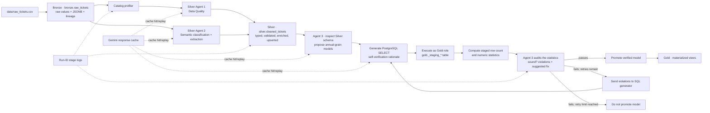

# Facilities Tickets Medallion Pipeline

A PostgreSQL and Python implementation of a Bronze → Silver → Gold pipeline for the operational ticket data in `data/raw_tickets.csv`. LangGraph coordinates the stages. Gemini assists with Silver data-quality and semantic tasks, and with Gold model design and review. Prompt responses are cached so an identical run can replay offline.

## Architecture



PostgreSQL schemas separate the data layers. The pipeline reads the source CSV and does not modify it.

## Medallion layers

### Bronze: `bronze.raw_tickets`

Bronze preserves each source record and provides a convenient set of known ticket columns for downstream SQL:

- CSV fields are read as strings, with empty values retained as empty strings.
- `_raw_data` stores the complete row as JSONB, including columns not in the known ticket schema.
- `_bronze_id` is the database identity for a stored Bronze row.
- `_row_hash` is a SHA-256 content fingerprint; identical rows can have the same hash.
- `_source_file_hash` and the 1-based `_source_row_number` form the source-row uniqueness key. Re-running the same file content is idempotent while repeated identical rows within that file remain distinct.
- `_source_file` records the resolved source path; `_ingested_at` records ingestion time.

Bronze ingestion loads through a temporary staging table and inserts with `ON CONFLICT DO NOTHING`. It is append-only for new source file content; it does not remove rows when a source file is changed or removed.

### Silver: `silver.cleaned_tickets`

Silver profiles Bronze, applies catalog-aware cleaning, repairs/enriches semantic fields, then upserts by cleaned `ticket_id`. Candidate ticket IDs are deduplicated with a deterministic `ROW_NUMBER()` ordering. Silver preserves the Bronze row reference and lineage fields (`_bronze_id`, `_source_file`, `_ingested_at`, `_row_hash`).

| Area | Implemented rule | Why it matters |
| --- | --- | --- |
| IDs and duplicate ticket IDs | Invalid or missing IDs receive a deterministic synthetic ID derived from `_row_hash`; repeated IDs are ranked and only the selected record is materialized for that key. | Stable keys let reruns upsert instead of multiplying Silver rows. The original records remain in Bronze. |
| Timestamps | The Data Quality Agent generates guarded PostgreSQL expressions for the supported timestamp formats and sentinels; unparseable values become `NULL`. | A consistent timestamp type supports time-based reporting and avoids invalid casts. |
| Temporal integrity | `resolved_at < created_at` is retained and flagged as `is_temporal_anomaly = TRUE`. | Analysts can exclude bad durations without losing the ticket or hiding the source issue. |
| Priority and status | Values are standardized using catalog rules (for example, priority tiers and lifecycle statuses); invalid values use the documented fallback. | Consistent enums support reliable grouping and filtering. |
| Cost and SLA | Currency formatting and sentinel values are sanitized before numeric casts; invalid or out-of-range values become `NULL`. | Prevents text sentinels and invalid values from distorting numeric summaries. |
| Category/description swaps | The Semantic Classification Agent reviews heuristic candidates and stores its resolution in `silver.dim_field_swap_cache`. | Repairs records where the short category and long description were put in the wrong fields. |
| Category taxonomy | Distinct raw labels are mapped to the canonical taxonomy and cached in `silver.dim_category_taxonomy`. | Consolidates colloquial or misspelled categories for cross-building reporting. |
| Free-text entities | Regex fast paths handle recognizable patterns; ambiguous distinct descriptions and resolution notes are sent to the LLM in batches. Results are cached in Silver entity tables using text hashes. | Extracts useful asset, room, duplicate, cause, action, and labor fields without one LLM call per ticket. |

The detailed catalog and prompt rules are in [`src/agents/catalog.py`](src/agents/catalog.py) and [`prompts.md`](prompts.md). Agent output is not blindly trusted: required catalog coverage is checked, generated Silver SQL must be a scalar expression, and the SQL safety guard rejects statement-like output before materialization.

### Gold: `gold.*`

Gold is produced by a separate closed-loop LLM workflow. It profiles the Silver schema and samples, proposes business models for each of the two configured business domains, generates PostgreSQL `SELECT` SQL, stages the result, checks row/numeric statistics, and retries with audit feedback up to the configured limit. A passing model is promoted to a Gold materialized view; a model that still fails the audit is not promoted.

The current configuration asks for two models from each of two configured domains, producing four models:

- `gold.annual_facilities_opex_summary` — annual cost, effort, and ticket counts by facility/category/assignee.
- `gold.annual_critical_risk_summary` — annual critical ticket counts, costs, and resolution time by facility/category/asset type.
- `gold.annual_asset_failure_summary` — annual incident count, failure cost, resolution time, and on-site hours by asset and root cause.
- `gold.annual_workforce_performance_summary` — annual resolved-ticket, labor cost, resolution-time, and first-time-fix metrics by workforce grouping.

The model names and SQL are proposed at run time, so they may change when prompts, inputs, or cache entries change. The evaluation brief suggests 2–3 Gold models; this implementation currently emits four because it asks each of two domains for two models. The full Gold model documentation is in [`docs/gold_models.md`](docs/gold_models.md): for each model it explains the business problem, stakeholder pain points, how the aggregation addresses them, observed data and audit statistics, and decisions the model can inform.

Gold SQL is constrained to one `SELECT` over `silver.cleaned_tickets` and its own CTEs. The target must be a safe `gold.*` name. Promotion and staging are application-owned operations. [`exports/`](exports/) contains example extracts; treat them as snapshots because the active Gold workflow generates model details at run time.

After Gold promotion, the pipeline exports each successfully promoted model to `exports/gold_<model_name>.csv`. For example, `gold.annual_facilities_opex_summary` is written to `exports/gold_annual_facilities_opex_summary.csv`. These files are refreshed on each full pipeline run.

## Agent roles and assessment

The pipeline has two agents in Silver and a third agent in Gold. The Gold Agent 3 flow is a separate closed-loop LangGraph workflow, not part of the Silver agent-evaluation harness.

| Agent | What it does | Example | Practical assessment |
| --- | --- | --- | --- |
| **Silver Agent 1: Data Quality** | Uses the dataset catalog and empirical profile to return per-column target types, cleaning expressions, detected anomalies, business risk, and table integrity rules. Its expressions feed Silver materialization after validation. | Mixed cost values such as `"$1,250.50"`, `"TBD"`, and `"-1"` → a guarded numeric-cleaning expression and anomaly rationale. | Useful for drafting many column rules from a profile. Requires review: early output included SQL constructs unsupported by PostgreSQL, so the prompt and execution guard now constrain the dialect. |
| **Silver Agent 2: Semantic Classification and Extraction** | Resolves field swaps, maps category labels, and extracts entities from descriptions/resolution notes. Regex handles clear cases; LLM calls are batched and results cached by text or lookup key. | `raw_category="Wasp nest on the third floor"`, `raw_description="Pest"` → swap decision, `clean_category="Pest"`, repaired description. | Helps with ambiguous language that fixed rules cannot cover well. Distinct-value processing, regex fast paths, batching, and database caching avoid a call for every source row. Human review is still appropriate for ambiguous classifications and extracted entities. |
| **Agent 3: Closed-Loop Gold Model Design** | Interprets the Silver schema, proposes annual-grain business models for configured domains, generates SQL, executes it in a staging table, asks an audit agent to check row/numeric summaries, and retries failed models with feedback. Passing models are promoted as Gold materialized views. | **Input:** Silver columns/samples plus the facilities OPEX domain. **Output example:** `gold.annual_facilities_opex_summary`, grouped by year, building, canonical category, and assignee; the latest run also proposed critical-risk, asset-failure, and workforce-performance summaries. | It speeds up model ideation and produces query scaffolding, but the audit only sees row counts and numeric distributions. A `statistically_sound` result does not validate metric definitions or stakeholder usefulness. No controlled timing study measured hours saved; treat it as a design accelerator and review the grain, filters, denominators, and SQL before relying on the marts. |

### Trust and override

- Review the DQ expressions when they affect financial values, timestamp parsing, or identity rules. A structurally valid expression can still implement the wrong business rule.
- Treat semantic mappings and extracted entities as suggestions when confidence is low or the source text is ambiguous.
- Check Gold model grain, filters, denominators, anomaly treatment, and business definitions before relying on a materialized view for decisions. In particular, the database audit checks row counts and numeric distributions; it does not prove every metric is conceptually correct.

## Database access boundaries

The pipeline provisions and assumes two PostgreSQL roles:

| Role | Read access | Write access |
| --- | --- | --- |
| `medallion_silver` | Bronze | Silver (including Silver caches and `cleaned_tickets`) |
| `medallion_gold` | Bronze and Silver | Gold outputs |

Stage-specific SQLAlchemy connection pools set the role on checkout. Agent-generated Gold SQL executes under the Gold role, so it cannot write Bronze or Silver even if it violates its prompt. Role grants and existing object ownership are set up idempotently by [`scripts/setup_stage_roles.sql`](scripts/setup_stage_roles.sql). Graph setup runs this script using `DATABASE_URL`; that account must be a PostgreSQL administrator able to create roles and transfer ownership. The provided Compose configuration uses `pipeline_user` for this trusted setup. There is no interactive permission prompt, but a non-admin external database account will not be able to provision the roles.

## LLM cache and offline replay

Structured Gemini responses are cached in `data/llm_cache/`. Cache keys include provider, model, temperature, exact prompt, and output schema. Files are written atomically. If prompt, input, model, or schema changes, the key changes and the request is a cache miss.

`LLM_CACHE_MODE` values:

- `read_write` (default): use an existing cache entry, or call Gemini and save a new response.
- `replay`: require an existing entry; never call Gemini; fail clearly on a miss.
- `refresh`: bypass the cache and call Gemini.

To run without an API key, submit the cache bundle with the code and run with `LLM_CACHE_MODE=replay`. The bundle must contain entries for all exact pipeline prompts and inputs. Cache files can contain model responses derived from ticket data; review them for sensitive content before publishing.

## Logging and evaluation

### Pipeline logs

Pipeline stage start, completion, duration, summaries, and failures are logged to the console and a separate file for each run under `logs/`. Files use the pattern `pipeline_<local timestamp>_<run_id>.log`, and the run-start event records the file name. The `run_id` is also included on every event, so a complete run can be found by opening its file or searching the ID. Logs include row/rule/enrichment counters where available, not full prompts or raw ticket payloads. The current code does not send alerts or expose a metrics dashboard.

### Agent evaluation harness

Run [`evals/run_agent_eval.py`](evals/run_agent_eval.py) separately from the pipeline invariant tests:

```bash
LLM_CACHE_MODE=replay python -m evals.run_agent_eval
```

It evaluates the **two Silver agents** using production prompt functions and a small synthetic labeled fixture:

- **Semantic Classification Agent:** exact taxonomy accuracy on 12 labels and exact swap decision/field-repair accuracy on 6 examples. These are submetrics of one agent, not separate agents.
- **Data Quality Agent:** output-contract checks for all catalog columns, target types, non-empty SQL, severity values, selected SQL guardrails, and table integrity rules. This is format/contract compliance, not semantic execution accuracy.

The semantic score averages taxonomy and swap accuracy; the overall score averages the two agent scores. Default gates are 85% taxonomy, 85% swap, 100% DQ format compliance, and 90% overall. Output includes case mismatches, latency, cache/provider call counts, and rough token estimates. If both `GEMINI_INPUT_USD_PER_1M_TOKENS` and `GEMINI_OUTPUT_USD_PER_1M_TOKENS` are configured, it also calculates an approximate cost from those rates. Otherwise cost is reported as `null`.

The fixture is small; a perfect score is a regression signal, not evidence of broad production accuracy. DQ checks mostly cover output contract/guardrails, and the harness does **not** evaluate entity extraction or Gold model design/SQL quality. A first run for uncached eval prompts requires a Gemini key unless the cache bundle already contains those responses.

To save a report:

```bash
LLM_CACHE_MODE=replay python -m evals.run_agent_eval --output evals/latest_report.json
```

To compare a candidate prompt/tool change with a previously saved report and fail on a score drop over five percentage points:

```bash
LLM_CACHE_MODE=read_write python -m evals.run_agent_eval \
  --baseline-report evals/baseline_report.json \
  --max-score-drop 0.05 \
  --output evals/candidate_report.json
```

If a prompt or schema changed, the cache key changes; that evaluation needs a Gemini key to create the candidate response before it can be compared. The baseline report should be a reviewed version that passed the current quality gates. This is a manual CLI gate, not CI automation.

### Pipeline invariant tests

[`tests/test_pipeline_invariants.py`](tests/test_pipeline_invariants.py) checks Bronze lineage, fixed Silver sample counts, and non-negative numeric values across all Gold materialized views discovered in the database. The Silver count assertions are specific to the supplied dataset and need updating if that input changes.

## What changes at 100× scale

The current pipeline is designed for a roughly 10k-row CSV, not daily million-row CDC:

- **Ingestion:** pandas reads the full CSV and Bronze computes file/row hashes in-process. Move to object storage plus incremental ingestion (CDC or partitioned micro-batches), persisted watermarks, and replay/backfill windows.
- **Profiling and Silver:** current profiling performs exact scans, and semantic steps scan distinct text across Bronze. Partition or incrementally profile changed records; use durable work queues and bounded retries.
- **LLM work:** current calls are synchronous and cached locally. Use provider batch APIs, centralized durable cache, strict token budgets, deduplication/semantic clustering, and human approval for low-confidence/high-impact changes.
- **Gold:** current models are rebuilt as complete materialized views. Use incremental models (for example, dbt over Iceberg/Delta or partitioned PostgreSQL tables), with late-arrival correction windows and deterministic backfills.
- **Operations:** add durable run metadata, freshness/volume/null-delta alerts, failure and cost SLAs, and evaluation dashboards.

## Quickstart

### Requirements

- Docker with Compose
- Python 3.9 or later
- A Gemini API key only if a required cache entry is missing or you set `LLM_CACHE_MODE=refresh`

### Run the full pipeline

1. Clone the repository and create the environment file:

   ```bash
   git clone https://github.com/PiyushVerma18/medallion-ai-pipeline
   cd medallion-ai-pipeline
   cp .env.example .env
   ```

   Keep the documented `DATABASE_URL` for the Compose database. For cached offline execution, set `LLM_CACHE_MODE=replay`; for new Gemini calls, set a valid `GEMINI_API_KEY` and use `read_write` or `refresh`.

2. Start PostgreSQL, create/activate a virtual environment, install dependencies, and run the pipeline:

   ```bash
   docker compose up -d
   python3 --version
   python3 -m venv .venv
   source .venv/bin/activate
   python -m pip install -r requirements.txt
   LLM_CACHE_MODE=replay python run_pipeline.py
   ```

   The pipeline runs Bronze ingestion, Silver, then Gold. The same invocation is safe to rerun: Bronze ignores previously ingested source rows, Silver upserts by ticket ID, and Gold replaces its own outputs.

### Run Silver only

Bronze must already be populated:

```bash
LLM_CACHE_MODE=replay python src/pipeline/silver_graph.py
```

### Repository checks

```bash
LLM_CACHE_MODE=replay python -m evals.run_agent_eval
python -m pytest tests/test_pipeline_invariants.py
```

The Silver count assertions in the invariant test are tied to the supplied dataset; the agent-evaluation command is the separate labeled-agent check.
